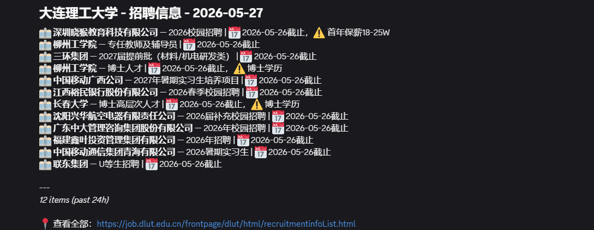
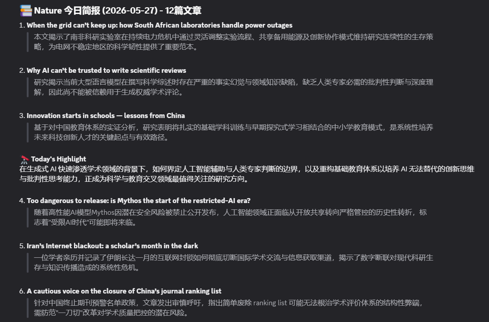
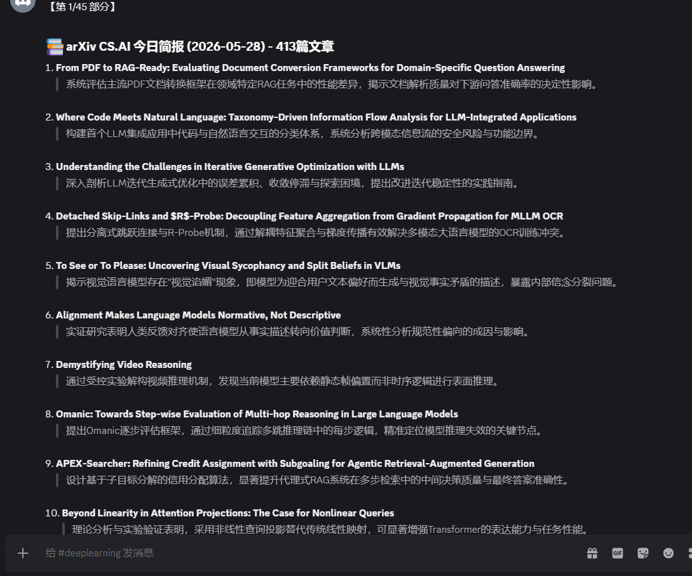
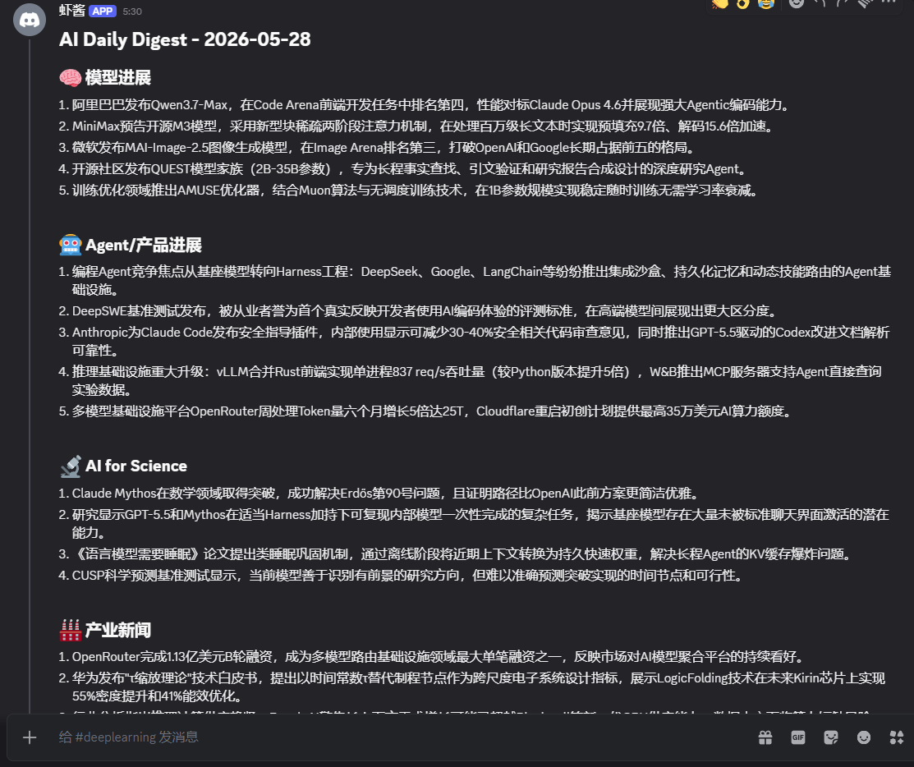
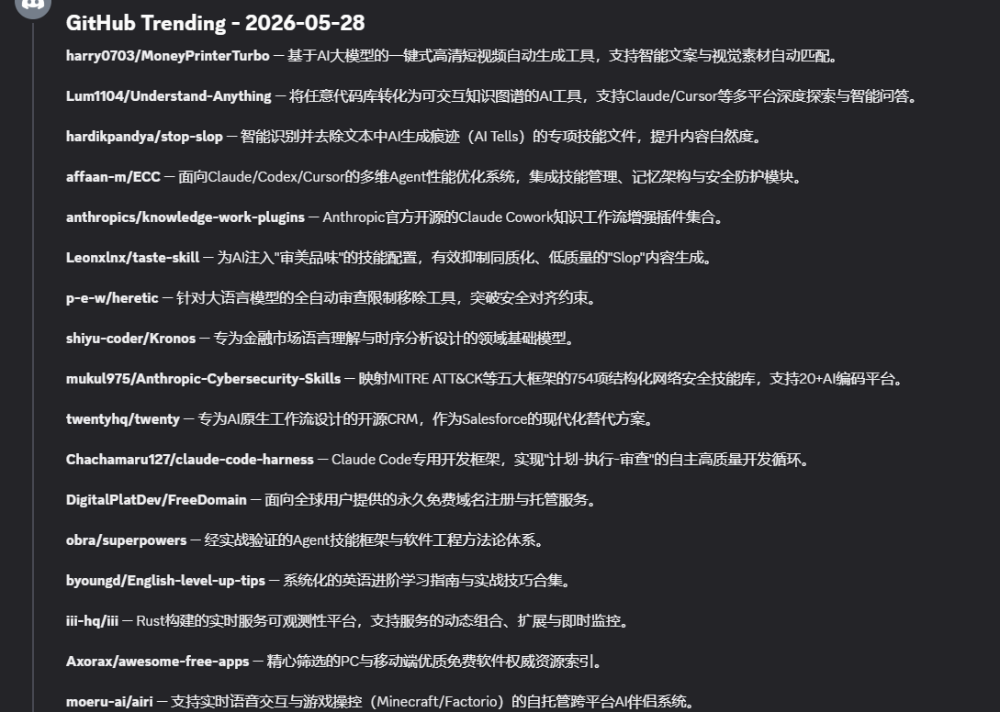

# DailyInfo

Read-only MCP access to generated or delivered briefings is an optional component. See [MCP connection and deployment](docs/mcp.md) for Streamable HTTP and per-user Bearer authentication, and [collection-only deployment](docs/production.md) for production without Discord publishing.

[中文](https://github.com/iHeadWater/dailyinfo/blob/main/README.zh-CN.md) | English

DailyInfo is an automated research intelligence collector for AI for Science researchers. Every day it gathers journal papers, AI news, arXiv preprints, code trends, university notices, and conference submissions from RSS feeds, scraped pages, APIs, and OpenReview — then turns them into concise Chinese-language briefings delivered to Discord and, optionally, the Web.

## How It Works

One orchestrated system, six independent information pipelines:

```text
FreshRSS / scrape / API / OpenReview
  -> dailyinfo run
  -> canonical PublicationStore (five regular categories)
     + conference SQLite + review briefings
  -> dailyinfo push / publish --sink web|discord
  -> Discord + Web + local archive
```

1. **Collect** — six independent pipelines pull from 40+ feeds, pages, APIs, and OpenReview. A failure in one never blocks the others.
2. **Summarize and finalize** — DeepSeek produces structured Chinese summaries. The five regular categories are validated into one canonical `PublicationBundle` per category/date; conference submissions and public reviews live in a dedicated SQLite store, with deterministic listings and AI review briefings.
3. **Deliver** — `dailyinfo push` sends Discord; `dailyinfo publish --sink web` sends the canonical Web bundle. Conference pushes a compact one-line-per-paper digest. Delivery state is independent and retryable.

You wake up to a curated digest of everything relevant to your field — no feed readers to check, no email, no noise.

## Features

| | |
|---|---|
| **Six pipelines** | Papers (30+ journals, including Chinese water-resources journals) · AI news · arXiv CS.AI (up to 500 preprints/day) · GitHub trending + HuggingFace models · University notices · Conference submissions (ICLR 2027, ICML 2027, NeurIPS 2026) |
| **Review-aware conference digest** | OpenReview submissions, public reviews, decisions, rebuttals, and rating signals; Discord gets one line per paper, detailed briefings stay local |
| **Chinese-first briefings** | AI summaries in Chinese with automatic fallback to a Zhipu GLM model when the primary API fails |
| **Configuration-driven** | Add RSS, scrape, or API sources in `config/sources.json` — no code changes required |
| **Idempotent & safe to rerun** | Sources with today's briefing are skipped; pushed files are never re-sent |
| **Resilient** | Retries with exponential backoff, batch splitting on partial AI responses, per-source isolation |
| **Self-hosted scheduler** | The compose stack runs daily collection, generation and Discord push on its own; Web publishing runs as a host-side dailyinfo launchd task (Node/git live on the host). External cron or agent runtimes remain optional |

## Screenshots

Put screenshots in `pictures/` with these names and they will render here.

### Discord Briefings

#### University Updates



#### Journal Papers



#### arXiv Papers



#### AI News



#### Code Trending



## Data Layout

Default data root: `~/.myagentdata/dailyinfo/`. Override it with `DAILYINFO_DATA_ROOT`.

```text
~/.myagentdata/dailyinfo/
├── freshrss/data/       # FreshRSS SQLite + config
├── conference/          # OpenReview SQLite (submissions, replies, review summary)
├── briefings/           # Files waiting to be pushed
│   ├── papers/
│   ├── ai_news/
│   ├── arxiv/
│   ├── code/
│   ├── resource/
│   └── conference/      # deterministic listing + detailed AI review briefings
├── pushed/              # Successfully pushed archive
│   ├── papers/
│   ├── ai_news/
│   ├── arxiv/
│   ├── code/
│   ├── resource/
│   └── conference/
├── publications/         # Canonical Publication v1 store
├── deliveries/           # Independent Discord/Web delivery state
└── state/                # Runtime markers and scheduler state
```

## Quick Start

```bash
git clone <repo-url>
cd dailyinfo

cp .env.example .env
# Fill DEEPSEEK_API_KEY, DISCORD_BOT_TOKEN, and OpenReview credentials for pipeline 6.

uv sync --python python3
uv pip install -e .
dailyinfo install

# Local development: FreshRSS container + manual run/push
dailyinfo start
dailyinfo run
dailyinfo push

# Production: self-hosted scheduler + read-only MCP
docker compose up -d

# macOS: host-side Web publishing at 07:40 (requires Node 22/npm/git)
./deploy/launchd/install-web-publish.sh
```

`dailyinfo install` validates `.env`, creates local data directories, and installs dependencies. It never writes host crontab entries: the compose stack owns the daily `run`/`push` jobs, while Web publishing is a separate host task. External cron/agent runtimes remain optional. See [Production Deployment](docs/production.md).

## Main Commands

| Command | Purpose |
|---------|---------|
| `dailyinfo install` | Validate environment and create data directories |
| `dailyinfo start` / `stop` / `restart` | Manage the development FreshRSS container |
| `dailyinfo run` | Run all six pipelines |
| `dailyinfo run -p 1` | Pipeline 1: journal papers |
| `dailyinfo run -p 2` | Pipeline 2: AI news |
| `dailyinfo run -p 3` | Pipeline 3: arXiv CS.AI |
| `dailyinfo run -p 4` | Pipeline 4: code trending |
| `dailyinfo run -p 5` | Pipeline 5: university notices |
| `dailyinfo run -p 6` | Pipeline 6: OpenReview conference submissions |
| `dailyinfo run -p 6 --source openreview_iclr_2027` | One conference source |
| `dailyinfo run -f all` | Force regeneration for all sources |
| `dailyinfo push` | Push pending briefings to Discord and archive them |
| `dailyinfo push -c conference` | Push only the conference review digest |
| `dailyinfo push -d 2026-04-22` | Push briefings for a specific date |
| `dailyinfo publish --sink web` | Publish canonical briefings to the configured `dailyinfo-web` checkout |
| `dailyinfo publish --sink discord` | Deliver canonical briefings to Discord |
| `dailyinfo publish --sink all` | Attempt Discord and Web independently |
| `dailyinfo publish --sink web --force` | Reconcile Web even when delivery state is already successful |
| `dailyinfo push -c weekly` | Push the weekly recap only |
| `dailyinfo weekly` | Generate a weekly AI news recap from recent briefings |
| `dailyinfo status` | Show today's briefing/archive counts |
| `dailyinfo logs` | Tail the execution log |
| `dailyinfo cache-clear` | Clear a source's FreshRSS cache (default `arxiv_cs_ai`) |
| `dailyinfo clean-cache` | Delete FreshRSS cache files older than N hours (default 24h) |

Scheduler operations inside the production stack:

```bash
docker compose exec scheduler python -m scripts.scheduler status
docker compose exec scheduler python -m scripts.scheduler healthcheck
```

## Environment Variables

| Variable | Purpose |
|----------|---------|
| `DEEPSEEK_API_KEY` | DeepSeek API key (primary model for `dailyinfo run`) |
| `DISCORD_BOT_TOKEN` | Discord bot token for `dailyinfo push` |
| `DISCORD_CHANNEL_PAPERS` / `_AI_NEWS` / `_ARXIV` / `_CODE` / `_RESOURCE` / `_CONFERENCE` | Optional category channel IDs; conference falls back to `_AI_NEWS` |
| `OPENREVIEW_EMAIL` / `OPENREVIEW_PASSWORD` | OpenReview credentials for pipeline 6 (email, not display name) |
| `FRESHRSS_USER` | FreshRSS username (also used by the compose stack) |
| `FRESHRSS_PASSWORD` | FreshRSS initial password |
| `FRESHRSS_BIND_ADDRESS` / `FRESHRSS_PORT` | Production FreshRSS Web UI bind address/port (default `127.0.0.1:8081`) |
| `FRESHRSS_IMAGE` | FreshRSS image (default `freshrss/freshrss:1.30.4`) |
| `FRESHRSS_CRON_MIN` | In-container RSS refresh interval (default `*/15`) |
| `FRESHRSS_LANGUAGE` / `FRESHRSS_BASE_URL` | FreshRSS install language/base URL for a new data directory |
| `DAILYINFO_DATA_ROOT` | Override default data root |
| `DAILYINFO_WEB_REPO` | Required local `dailyinfo-web` checkout for Web publishing |
| `DAILYINFO_WEB_REMOTE` | Expected Web `origin` URL (default official repository) |
| `DAILYINFO_WEB_BRANCH` | Expected Web branch (default `main`) |
| `GLM_API_KEY` | Zhipu GLM API key (optional, used for fallback model) |
| `DAILYINFO_ENV` | Environment: `prod` / `dev` / `staging` (default `prod`) |
| `DAILYINFO_FALLBACK_MODEL` | Fallback model when DeepSeek returns empty (default `glm-5.3-flash`, a Zhipu model name) |

## Scheduling and Agents

Production scheduling is owned by dailyinfo: the `scheduler` container reads `deploy/crontab.*` through supercronic, records job outcomes, catches up missed jobs, and exposes a healthcheck. Web publishing is a host-side dailyinfo launchd task at 07:40 because it needs Node 22/npm and git push credentials. `dailyinfo install` never writes host crontab entries.

| Responsibility | Owner |
|----------------|-------|
| FreshRSS container and local data layout | DailyInfo |
| `dailyinfo run` / `push` / `publish` | DailyInfo |
| Timed `run` / `push` | dailyinfo `scheduler` container (default); external cron, myopenclaw, or agent runtime optional |
| Timed Web publish | dailyinfo host launchd task (macOS default); systemd timer/cron on Linux |

> Pipeline 6 (conference) is not yet part of `deploy/crontab.*`. Until the scheduler follow-up lands, run it manually with `dailyinfo run -p 6` and `dailyinfo push -c conference`, or add it to an external cron.

## Documentation

- [Architecture](docs/architecture.md)
- [CLI Reference](docs/cli.md)
- [Agent Config](docs/agent-config.md)
- [Information Sources](docs/sources.md)
- [Read-only MCP](docs/mcp.md)
- [Production Deployment](docs/production.md)

## License

BSD 3-Clause License. See [LICENSE](LICENSE) for details.
