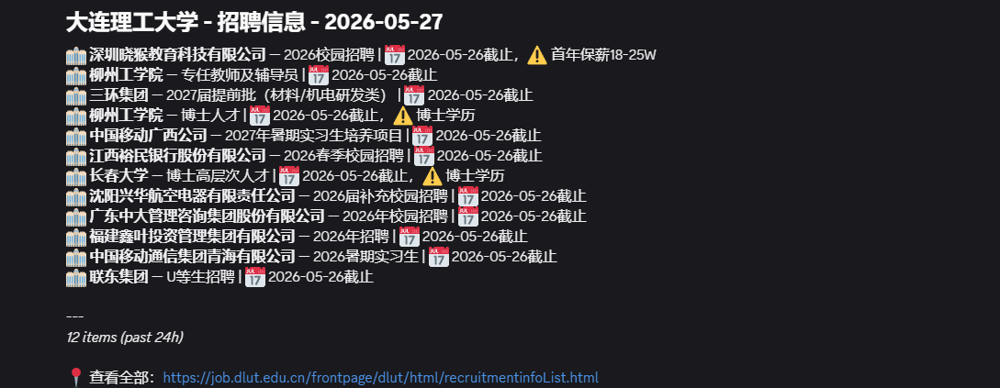
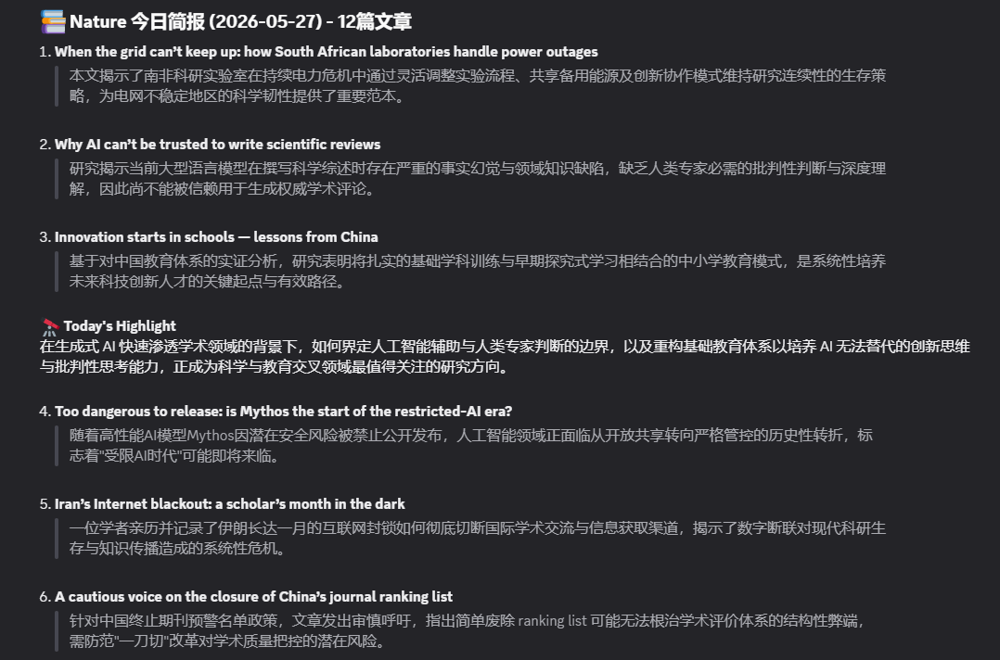
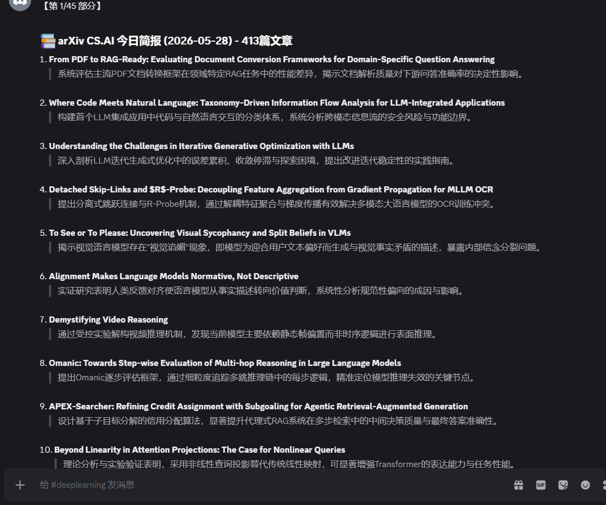
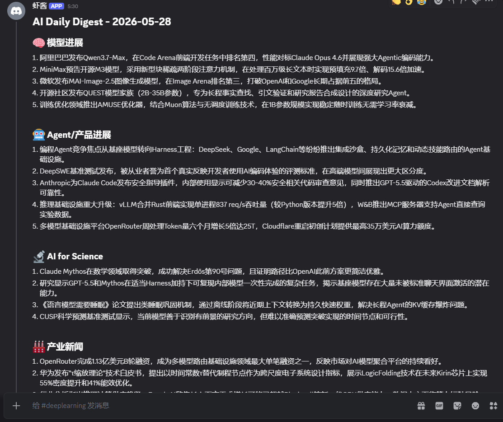
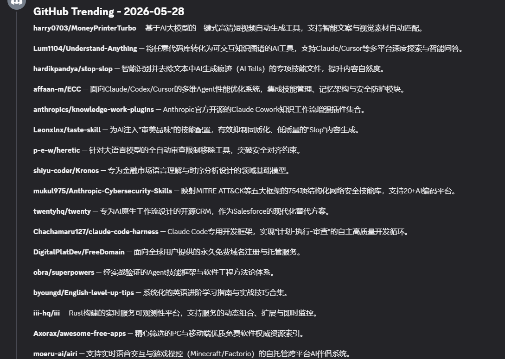

# DailyInfo

只读 MCP 是可选组件，用于查询已生成或已投递的简报；Streamable HTTP、一人一 key 的接入方式见 [MCP 接入与部署](docs/mcp.md)，不推送 Discord 的纯采集部署见[生产部署](docs/production.md)。

中文 | [English](README.md)

DailyInfo 是面向 AI for Science 研究者的自动化科研情报收集器。每天自动从 RSS 源、网页、API 和 OpenReview 聚合期刊论文、AI 资讯、arXiv 预印本、代码趋势、院所通知和会议投稿，再用 DeepSeek 生成简洁的中文简报，推送到 Discord，并可选发布到 Web。

## 工作原理

一套编排系统，六条相互独立的信息流水线：

```text
FreshRSS / 网页抓取 / API / OpenReview
  -> dailyinfo run
  -> 五类 canonical PublicationStore
     + 会议 SQLite + 评审简报
  -> dailyinfo push / publish --sink web|discord
  -> Discord + Web + 本地归档
```

1. **采集** — 六条独立流水线从 40+ 个 feed、页面、API 和 OpenReview 拉取信息。一条流水线失败不影响其他。
2. **归纳** — DeepSeek 生成中文摘要。五类常规内容会校验并写入每个类别/日期唯一的 canonical `PublicationBundle`；会议投稿和公开评审进入独立 SQLite，生成确定性清单和 AI 评审简报。
3. **推送** — `dailyinfo push` 发送 Discord，`dailyinfo publish --sink web` 发布 canonical Web bundle；会议只推每篇一句话的速览。投递状态独立、可重试。

每天醒来,你的领域内值得关注的一切已经整理成一份中文摘要等你查看——不用刷 feed 阅读器,没有邮件轰炸,没有噪音。

## 特性

| | |
|---|---|
| **六条流水线** | 期刊论文(30+ 期刊,含中文水利期刊)· AI 资讯 · arXiv CS.AI(每日最多 500 篇)· GitHub Trending + HuggingFace 模型 · 院所通知 · 会议投稿(ICLR 2027 / ICML 2027 / NeurIPS 2026) |
| **评审感知的会议速览** | OpenReview 投稿、公开评审、decision、rebuttal、评分信号;Discord 每篇一句话,详细简报留在本地 |
| **中文优先简报** | AI 生成中文摘要;主模型 API 故障时自动降级到智谱 GLM 备用模型 |
| **配置驱动** | 在 `config/sources.json` 中添加 RSS、网页或 API 数据源,无需改代码 |
| **幂等,可安全重跑** | 已有今日简报的数据源自动跳过;已推送文件不会重复发送 |
| **高容错** | 指数退避重试、AI 响应不完整时自动拆分批次、数据源级隔离 |
| **自带调度** | 容器栈自己完成每日采集、生成与推送;外部 cron / agent runtime 仍可选用 |

## 效果展示

把截图放到 `pictures/` 并使用下面的文件名后,会自动显示在这里。

### Discord 简报推送

#### 学校资讯



#### 期刊论文



#### arXiv 论文



#### AI 资讯



#### Code Trending



## 数据目录

默认数据根目录是 `~/.myagentdata/dailyinfo/`,可通过 `DAILYINFO_DATA_ROOT` 覆盖。

```text
~/.myagentdata/dailyinfo/
├── freshrss/data/       # FreshRSS SQLite + 配置
├── conference/          # OpenReview SQLite（投稿、回复、评审摘要）
├── briefings/           # 待推送文件
│   ├── papers/
│   ├── ai_news/
│   ├── arxiv/
│   ├── code/
│   ├── resource/
│   └── conference/      # 确定性清单 + 详细 AI 评审简报
├── pushed/              # 已推送归档
│   ├── papers/
│   ├── ai_news/
│   ├── arxiv/
│   ├── code/
│   ├── resource/
│   └── conference/
├── publications/         # Canonical Publication v1 存储
├── deliveries/           # 独立的 Discord/Web 投递状态
└── state/                # 运行标记和调度状态
```

## 快速开始

```bash
git clone <repo-url>
cd dailyinfo

cp .env.example .env
# 填写 DEEPSEEK_API_KEY、DISCORD_BOT_TOKEN,以及 pipeline 6 的 OpenReview 凭据。

uv sync --python python3
uv pip install -e .
dailyinfo install

# 本地开发：FreshRSS 容器 + 手动 run/push
dailyinfo start
dailyinfo run
dailyinfo push

# 生产：自带调度的采集器 + 只读 MCP
docker compose up -d
```

`dailyinfo install` 会校验 `.env`、创建本地数据目录并安装依赖,不会写入宿主 crontab;生产调度由 compose 栈负责,外部 cron / agent runtime 仍可选用。详见[生产部署](docs/production.md)。

## 常用命令

| 命令 | 用途 |
|------|------|
| `dailyinfo install` | 校验环境并创建数据目录 |
| `dailyinfo start` / `stop` / `restart` | 管理开发用 FreshRSS 容器 |
| `dailyinfo run` | 运行全部六条流水线 |
| `dailyinfo run -p 1` | 流水线 1：期刊论文 |
| `dailyinfo run -p 2` | 流水线 2：AI 资讯 |
| `dailyinfo run -p 3` | 流水线 3：arXiv CS.AI |
| `dailyinfo run -p 4` | 流水线 4：代码趋势 |
| `dailyinfo run -p 5` | 流水线 5：院所通知 |
| `dailyinfo run -p 6` | 流水线 6：OpenReview 会议投稿 |
| `dailyinfo run -p 6 --source openreview_iclr_2027` | 只跑一个会议源 |
| `dailyinfo run -f all` | 强制重生全部数据源 |
| `dailyinfo push` | 推送待处理简报到 Discord 并归档 |
| `dailyinfo push -c conference` | 只推送会议速览 |
| `dailyinfo push -d 2026-04-22` | 推送指定日期简报 |
| `dailyinfo publish --sink web` | 发布 canonical 简报到 `dailyinfo-web` |
| `dailyinfo publish --sink discord` | 通过 canonical 链路发送 Discord |
| `dailyinfo publish --sink all` | 独立尝试 Discord 和 Web |
| `dailyinfo push -c weekly` | 只推送每周回顾 |
| `dailyinfo weekly` | 从近期简报生成每周 AI 资讯回顾 |
| `dailyinfo status` | 查看当天简报和归档数量 |
| `dailyinfo logs` | 查看执行日志 |
| `dailyinfo cache-clear` | 清除指定源的 FreshRSS 缓存(默认 `arxiv_cs_ai`) |
| `dailyinfo clean-cache` | 删除超过 N 小时的 FreshRSS 缓存文件(默认 24h) |

生产栈内的调度操作：

```bash
docker compose exec scheduler python -m scripts.scheduler status
docker compose exec scheduler python -m scripts.scheduler healthcheck
```

## 环境变量

| 变量 | 用途 |
|------|------|
| `DEEPSEEK_API_KEY` | `dailyinfo run` 使用的 DeepSeek API key(主模型) |
| `DISCORD_BOT_TOKEN` | `dailyinfo push` 使用的 Discord bot token |
| `DISCORD_CHANNEL_PAPERS` / `_AI_NEWS` / `_ARXIV` / `_CODE` / `_RESOURCE` / `_CONFERENCE` | 可选分类频道 ID;会议未配置时回落到 `_AI_NEWS` |
| `OPENREVIEW_EMAIL` / `OPENREVIEW_PASSWORD` | pipeline 6 的 OpenReview 凭据(邮箱,不是显示名) |
| `FRESHRSS_USER` | FreshRSS 用户名 |
| `FRESHRSS_PASSWORD` | FreshRSS 初始密码 |
| `DAILYINFO_DATA_ROOT` | 覆盖默认数据根目录 |
| `DAILYINFO_WEB_REPO` | 发布 Web 所需的本地 `dailyinfo-web` checkout |
| `DAILYINFO_WEB_REMOTE` | 期望的 Web `origin` URL(默认官方仓库) |
| `DAILYINFO_WEB_BRANCH` | 期望的 Web 分支(默认 `main`) |
| `GLM_API_KEY` | 智谱 GLM API key(可选,用于备用模型) |
| `DAILYINFO_ENV` | 环境：`prod` / `dev` / `staging`(默认 `prod`) |
| `DAILYINFO_FALLBACK_MODEL` | 主模型空响应时的备用模型(默认 `glm-5.3-flash`,智谱模型名) |

## 调度和 Agent 分工

生产调度由 dailyinfo 的 compose 栈负责：`scheduler` 容器通过 supercronic 读取 `deploy/crontab.*`,记录 job 结果、补跑漏掉的任务并提供 healthcheck。`dailyinfo install` 不会写宿主 crontab。

| 职责 | 归属 |
|------|------|
| FreshRSS 容器和本地数据目录 | DailyInfo |
| `dailyinfo run` / `push` / `publish` | DailyInfo |
| 定时执行 | dailyinfo `scheduler` 容器(默认);外部 cron、myopenclaw 或 agent runtime 可选 |

> pipeline 6(会议)目前还没有加入 `deploy/crontab.*`。在调度 follow-up 完成前,需要手动运行 `dailyinfo run -p 6` 和 `dailyinfo push -c conference`,或自己加到外部 cron。

## 文档

- [系统架构](docs/architecture.md)
- [CLI 参考](docs/cli.md)
- [Agent 配置](docs/agent-config.md)
- [数据源说明](docs/sources.md)
- [只读 MCP 接入与部署](docs/mcp.md)
- [生产部署](docs/production.md)

## License

BSD 3-Clause License. See [LICENSE](LICENSE) for details.
